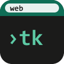
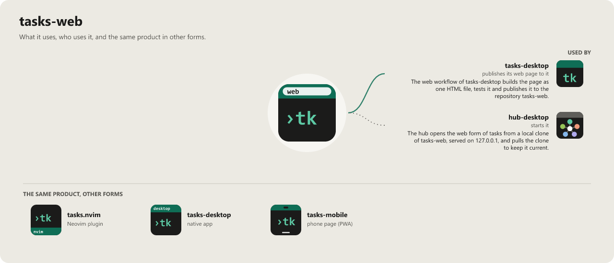

# tasks-web

The page of [tasks-desktop](https://github.com/WKDSteve/tasks-desktop) as a single HTML file that Chrome opens
from disk (`file://`). No install, no server, no host: the file makes no network request (its CSP forbids it), and
the vault comes from a local folder you pick in the browser.

This repository holds the built pages and their sums (the sources live in tasks-desktop; its build writes here, do
not edit them by hand), plus this README, the start script `start-tasks.cmd` and the license files.

## Learning paths

The page shows learning paths (`#view=paths`, `#view=pathmap`); it does not create them. How to make one, with checklists for
before writing, for each point and for finishing: [LEARNING-PATH-WORKFLOW.md](https://github.com/WKDSteve/tasks.nvim/blob/main/docs/LEARNING-PATH-WORKFLOW.md)
in tasks.nvim (the same document serves the editor, the desktop app and the phone). The checks to make in the page are in
[tasks-desktop/docs/LEARNING-PATHS.md](https://github.com/WKDSteve/tasks-desktop/blob/main/docs/LEARNING-PATHS.md).

## Now: the probe

`probe.html` checks whether this works on a machine at all, before the real page is built. It reads nothing but
the folder you pick.

```
git clone https://github.com/WKDSteve/tasks-web.git
```

1. Check the file: `Get-FileHash probe.html` must match the line in `SHA256SUMS`.
2. Open `file:///C:/repos/tasks-web/probe.html` in Chrome (adjust the path).
3. Create an **empty** test folder. Never pick a real vault.
4. Press button 1 and pick the test folder. The page writes, renames and deletes one file in it, called
   `tasks-web-probe.txt`.
5. Reload the page, then close and reopen Chrome, and each time press button 2. After the restart, the line
   "Marker of the previous visit" shows whether Chrome kept the page's storage at all (a time in both
   places) or wiped it (`none`).
6. Press "Copy result" and keep the text (for example for an issue in tasks-desktop).
7. In `chrome://policy`, filter for `FileSystem` and for `URL` and note what is set.

Update later with `git pull`.

## Now: the engine check

`engine-check.html` starts the tasks.nvim engine in the browser, on a small synthetic test vault that is part
of the file (it reads no folder of this machine). Open it like the probe, wait until every line is there, press
"Copy result" and keep the text (for example for an issue in tasks-desktop).

## Now: the page

`tasks.html` is the full page of tasks-desktop with the tasks.nvim engine running in the browser. It reads and
writes the vault folder you pick (create, set a field, done, move). **Try writing on a copy of the vault first.**

1. `git pull`, then check the file: `Get-FileHash tasks.html` must match the line in `SHA256SUMS`.
2. Open `file:///C:/repos/tasks-web/tasks.html` in Chrome (adjust the path).
3. Press "Choose folder ..." (German: "Ordner wählen ...") and pick the vault (the folder that holds the areas). The page reads the `*.md`
   files, `areas.json`, `area-groups.json` and `tasks-vault.json` into memory; `.git` and other hidden folders are skipped.
   A folder with no area (a folder with `ROADMAP/` or `Backlog/` in it) is refused with a notice, as it would show an
   empty vault: usually the folder above the vault or one area was picked. When the vault lies one level down, the
   notice names that folder.
4. After a restart of Chrome the page shows the vault used last: press "Allow access" ("Zugriff erlauben") once (no picker).
5. Changes on disk show up when the tab gets focus again, or within 30 seconds.
6. Writing: before it writes, the page compares every file it touches with what it read. If one changed on disk
   meanwhile, it writes nothing, says so (conflict), and reads the folder again; then repeat the action. A write that
   fails half way is rolled back. Do not close the tab while it writes (the browser asks). Then commit with git as
   usual.
7. Data classes: the vault's `areas.json` says which areas may be kept in the browser's storage (the list cache). An
   area without a class is never stored. If `areas.json` is missing or unusable, nothing is cached and every area
   counts as unclassified.

### Start it with a click (Windows)

The everyday start is a shortcut that points at the browser itself: a click on "tasks-web" starts Chrome with the page and
nothing else, no script, no `cmd`, no git, no PowerShell. `start-tasks.cmd` next to `tasks.html` is the tool that makes
this shortcut once and that updates the page when you ask for it; no Neovim, no install. It is a plain batch file: read
it before running it. Scripts and shortcuts from elsewhere are worth checking before you open them, and security
software or the policies of a machine may report or block them; if in doubt, do not run it, open the file by hand as
above and make the shortcut from the page (see below).

```
start-tasks.cmd /shortcut    once: a shortcut "tasks-web" on the desktop and in the Start menu that starts Chrome
                             with the page in a window of its own
start-tasks.cmd /update      pull and check only, start nothing: the way to update the page
start-tasks.cmd              update, check, then the page in a tab of Chrome
start-tasks.cmd /app         the same, in a window of its own (no tabs, its own button in the taskbar)
start-tasks.cmd /print       print what would be started, start nothing
... /noupdate                as second word: no pull (the check below still runs)
```

**The shortcut.** `/shortcut` finds Chrome, works out the address of the page and writes both into the link: its
target is `chrome.exe`, its argument `--app=file:///...`. Without Chrome the link points at `tasks.html` and the
default browser opens it (read only outside Chrome and Edge). After `/shortcut`, "tasks-web" is found by the Start
menu search (typing "tasks" finds it); pin it to the taskbar from there (right click, "Pin to taskbar"). The link
holds the paths of the day it was made: run `/shortcut` again after moving the clone or after Chrome moved.

The link is named `tasks-web` and not `tasks`: the native app (tasks-desktop) has a link "Tasks" in the Start menu,
and Windows takes `tasks.lnk` and `Tasks.lnk` for one file, so an earlier version of this script wrote over it. The
script never writes over a link that is not its own (it says so and ends with an error). A link `tasks` made by an
earlier version (it ran the script at every click, through `cmd.exe`, minimized) is taken away when `/shortcut` runs
again; if that earlier run replaced the link of the native app, `tasks-hub install` there makes it again.

**Updates.** A click on the shortcut does not update the page. To update, run `start-tasks.cmd /update` in a terminal
(or with Win+R): it runs `git pull --ff-only` in this folder (without git, outside a clone, or offline it says so),
then checks `tasks.html` against its line in `SHA256SUMS` and says when the file does not match (look at
`git status`). The script itself, started without `/shortcut`, does the same before it opens the page and does not
open a file that does not match. In the page, Options > "Update the page ..." ("Seite aktualisieren ...") names the
build of the page and gives the two lines to copy (the script with `/update`, or `git pull`); the page itself cannot
fetch anything (no request) nor start git. Reload the page after the pull.

Without the script: in the page, Options > "Create a shortcut ..." ("Verknüpfung anlegen ...") shows the line to copy
for Windows' own "New > Shortcut" (right click on the desktop): Chrome with a window of its own, or the plain address
for the default browser.

Missing compared to the app: tray, autostart, notifications, "show in Explorer", "open in editor", attaching
screenshots, several vaults at once, finishing or moving a folder task that holds assets. Every local HTML file in
Chrome shares the origin `file://`, so open no other local page you do not trust in the same profile (details:
`docs/SECURITY.md` in tasks-desktop).

## License

MIT, see [LICENSE](LICENSE). The pages bundle third-party code (Lua 5.4 via wasmoon, Svelte, markdown-it and
others) under their own licenses, listed in [THIRD-PARTY-NOTICES.md](THIRD-PARTY-NOTICES.md).

<!-- connections:begin (written by the app-icons tool of the workshop; change integrations.json there, not this block) -->
## Connections



**Used by**

- [hub-desktop](https://github.com/WKDSteve/hub-desktop): The hub opens the web form of tasks from a local clone of tasks-web, served on 127.0.0.1, and pulls the clone to keep it current. ([picture](assets/graphs/pair/hub-desktop--tasks-web.png))
- [tasks-desktop](https://github.com/WKDSteve/tasks-desktop): The web workflow of tasks-desktop builds the page as one HTML file, tests it and publishes it to the repository tasks-web. ([picture](assets/graphs/pair/tasks-desktop--tasks-web.png))
<!-- connections:end -->
